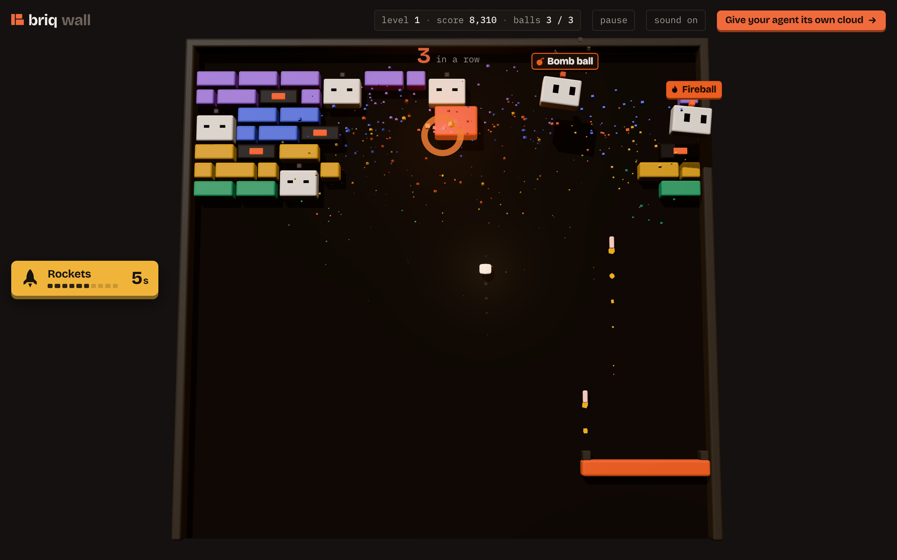

<p align="center"></p>

<h1 align="center">briq wall</h1>

<p align="center">A brick breaker in three.js. Break the wall, wake the agents sleeping in it, catch them for a power.</p>

## Run it on briq

Ask your agent, once [briq](https://briq.cloud) is connected:

```text
Deploy briq-cloud/wall github repo on briq (https://briq.cloud/docs/guides/run-a-github-repo.md) and give me a link to it.
```

It is a static site, so it runs on the `static` recipe. The briq downloads the repo itself:

```text
briq_run({
  recipe: "static",
  params: { repo: { url: "github.com/briq-cloud/wall" } },
  expose: "public"
})
```

## Run it locally

No build, no dependencies to install:

```bash
python3 -m http.server 8000
```

Then open http://localhost:8000. Add `?autoplay` to the URL to watch the computer play.

## Play

| | |
|---|---|
| Move | mouse, touch, ← → or A D |
| Launch | click, tap or space |
| Pause | P, or the pause button |
| Sound | M |

Hit an agent to wake it, then catch it with the paddle:

| Power | What it does |
|---|---|
| Three balls | the ball splits into three |
| Bomb ball | the next 3 bricks explode |
| Rockets | the paddle fires for 8 s |
| Fireball | the ball burns through bricks for 7 s |
| Wider paddle | for 15 s |
| Extra ball | a lost ball comes back |

Dark bricks explode and set off the ones next to them. The orange B takes three hits.

## Share

- `share`, in the header: a post about the wall with its link, for X, LinkedIn or Bluesky, or to copy.
- At the end of a game: your score card, to post, copy or save as an image.

## Inside

- `index.html`, `style.css`: the page, the menu and the HUD.
- `src/main.js`: the scene, the physics and the game.
- `src/levels.js`: the walls, the agents and their powers.
- `src/card.js`: the score card, drawn on canvas. The same drawing without a score is the link preview, `assets/og.png`.
- `src/icons.js`, `src/shapes.js`, `src/palette.js`: the power icons, the briq mark and agent, the colours.
- `src/audio.js`: sound effects, made with WebAudio.

three.js is loaded from jsDelivr through an import map.

## License

MIT
